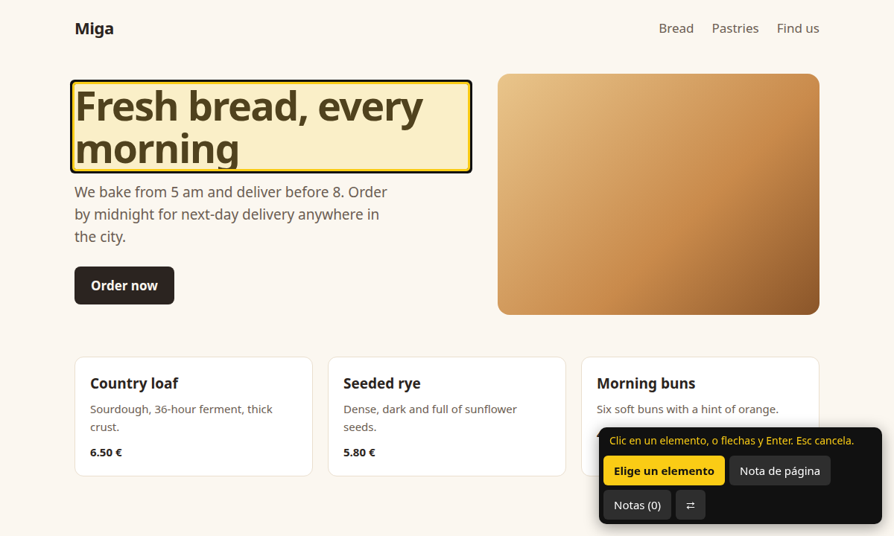
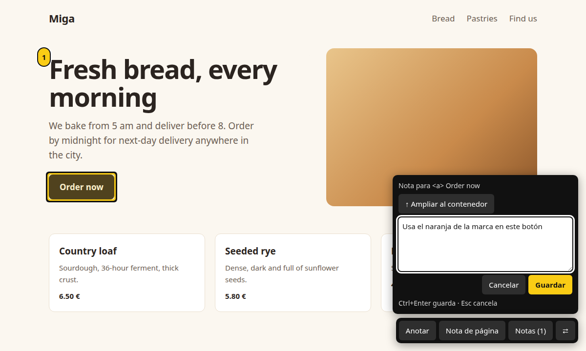
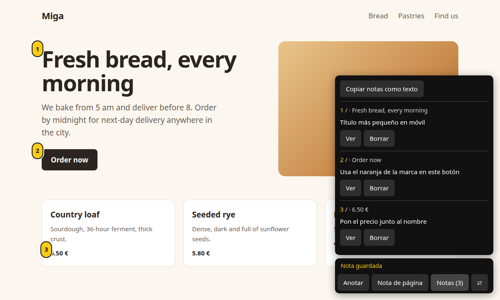

# annotate

[Web](https://codecruz.github.io/annotate/) · [English](README.md)

Señala cosas en la web que tienes en local, escribe qué quieres cambiar y
deja que Claude Code lo haga.

`annotate` es un plugin de Claude Code. Arranca un proxy local pequeño
delante de la web que ya estás sirviendo, añade una capa de anotación a cada
página y guarda tus notas en `.annotations.json`, dentro del proyecto. Cuando
terminas, Claude lee el archivo y hace el trabajo.

## Instalación

En Claude Code:

```
/plugin marketplace add codecruz/claude-plugins
/plugin install annotate@codecruz
```

Después abre una sesión nueva o ejecuta `/reload-plugins`.

## Cómo funciona

1. Sirve tu proyecto en local como siempre.
2. Ejecuta `/annotate:start`, o simplemente pídelo («quiero anotar la web»).
3. Abre la dirección que te da Claude, pulsa **Anotar**, haz clic en un
   elemento y escribe la nota. Repite en cualquier página.
4. Pulsa **Enviar a Claude** en la página, ejecuta `/annotate:apply`, o dile
   a Claude que has terminado. Busca el
   código de cada elemento marcado, hace el cambio y borra la nota. Los pines
   que quedan son trabajo pendiente.

| Comando | Qué hace |
| --- | --- |
| `/annotate:start [url o puerto]` | Abre una sesión sobre tu web local. |
| `/annotate:apply` | Aplica las notas y borra las resueltas. |
| `/annotate:stop` | Cierra la sesión. Las notas abiertas se conservan. |

## Cómo se ve

**1. Elige.** Pulsa **Anotar** y señala el elemento. Se resalta al pasar por
encima.



**2. Escribe.** Di lo que quieres con tus palabras. Si el clic ha caído
demasiado dentro, **Ampliar al contenedor** sube la nota un nivel.



**3. Revisa.** Cada nota deja un pin numerado. **Notas** las lista todas,
también las de otras páginas, te lleva a cada una y puede copiarlas como
texto.



**4. Aplica.** Claude lee las notas, busca el código de cada elemento y hace
el cambio. En una sesión real sobre un portfolio, diez notas dejadas en la
página de inicio se aplicaron de una pasada y el archivo volvió vacío: si no
quedan pines, no queda nada pendiente.

## La capa de anotación

| Control | Qué hace |
| --- | --- |
| **Anotar** (`Alt+A`) | Empieza a elegir. Haz clic en un elemento o usa el teclado. |
| Flechas y `Enter` | Recorren la página mientras eliges: arriba al contenedor, abajo a su interior, izquierda y derecha entre hermanos. `Enter` elige. |
| **Ampliar al contenedor** | Pasa la nota al elemento padre. |
| **Nota de página** | Deja una nota sobre la página entera. |
| **Guardar** (`Ctrl+Enter`) | Guarda la nota. Las notas se escriben en disco con cada cambio. |
| **Notas** | Lista todas las notas, de cualquier página. Edítalas, bórralas o cópialas todas. |
| Un pin | Vuelve a abrir su nota. |
| **Enviar a Claude** | Le dice a Claude que empiece con las notas, sin volver al chat. |
| **⇄** | Pasa la barra a la otra esquina cuando tapa algo. |
| `Esc` | Cancela. |

La capa funciona con ratón, pantalla táctil y teclado, y con lector de
pantalla. Se muestra en español si el navegador está en español y en inglés
en los demás casos. Escribe las notas en el idioma que quieras.

## Qué guarda una nota

```json
{
  "path": "/precios",
  "selector": "#main > section > h1",
  "tag": "h1",
  "text": "Pan recién hecho cada mañana",
  "html": "<h1 class=\"title\">Pan recién hecho cada mañana</h1>",
  "viewport": "390x800",
  "theme": "dark",
  "note": "Demasiado grande en móvil"
}
```

La página, el elemento y su texto, el tamaño de la ventana y el tema de color
viajan con la nota, para que «demasiado grande en móvil» llegue con su
contexto. Cada nota lleva además un `id`, las `classes` del elemento y una
fecha `created`.

`.annotations.json` son datos de trabajo, no código. Déjalo fuera del control
de versiones; Claude lo añade a `.git/info/exclude` al abrir una sesión.

## Otras IA

El proxy y la capa no dependen de Claude: son Node sin más y un archivo
JSON. Clona este repositorio y, con cualquier otro asistente:

```
node skills/annotate/server.mjs --proxy http://localhost:<puerto-de-tu-web>
```

| Opción | Por defecto | Significado |
| --- | --- | --- |
| `--proxy` | obligatoria | La web local que quieres anotar. Solo se acepta `localhost`. |
| `--port` | `4400` | Dónde se sirve la copia anotable. |
| `--out` | `.annotations.json` | El archivo de notas, relativo a la carpeta actual. |
| `--open` | desactivada | Abre la copia anotable en tu navegador por defecto, en primer plano. |

Anota y después indica al asistente el archivo de notas, o abre **Notas** y
pulsa **Copiar notas como texto** para obtener un resumen en Markdown que
puedes pegar en cualquier chat. `node skills/annotate/wait.mjs [puerto]`
se queda esperando hasta que pulsas **Enviar a Claude** y entonces imprime
`apply`: un asistente que ejecute comandos en segundo plano puede usarlo
como señal.

## Privacidad y seguridad

- Todo se queda en tu ordenador. Sin cuentas, sin llamadas de red, sin
  analítica.
- El proxy solo es accesible desde tu propio ordenador, en `localhost`
  (`127.0.0.1`), y solo reenvía a una web que también esté en `localhost`.
- Solo acepta notas y la señal de **Enviar a Claude** de las páginas que él
  mismo sirve, así que otra web abierta en tu navegador no puede colar una
  nota ni arrancar el trabajo.
- La capa no cambia los archivos de tu proyecto: se añade a las páginas al
  vuelo, solo mientras la sesión está abierta.

## Requisitos y límites

- Node 20 o superior. Sin dependencias.
- Las notas se ponen sobre un elemento o sobre la página entera, no sobre
  zonas libres ni texto seleccionado.
- No reenvía WebSockets, así que la recarga en caliente no funciona a través
  del proxy: recarga la página después de un cambio.
- Una Content-Security-Policy estricta en una etiqueta `<meta>` bloquea la
  capa.

## Desarrollo

```
npm test                         # pruebas del proxy, sin dependencias
claude --plugin-dir .            # prueba el plugin desde esta carpeta
```

| Ruta | Qué es |
| --- | --- |
| `skills/annotate/SKILL.md` | Lo que hace Claude en una sesión. |
| `skills/annotate/server.mjs` | El proxy. |
| `skills/annotate/client.js` | La capa de anotación. |
| `commands/` | Los tres comandos. |
| `docs/` | La web, publicada con GitHub Pages. |

## Licencia

MIT
