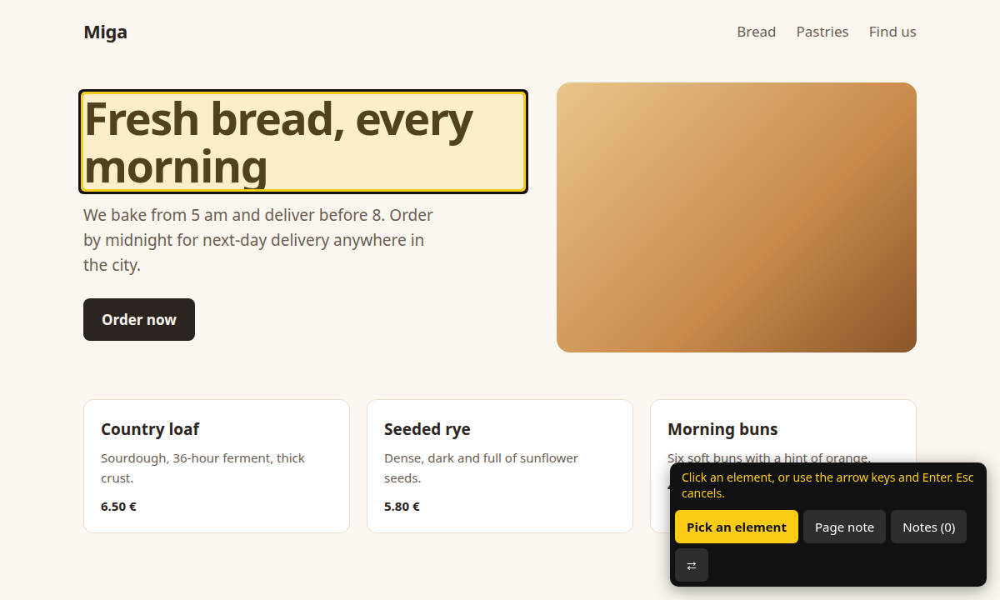

# annotate

[Website](https://codecruz.github.io/annotate/) · [Español](README.es.md)

Point at things on your locally running site, write what you want changed,
and let Claude Code carry out the notes.

`annotate` is a Claude Code plugin with one skill. It starts a small local
proxy in front of the site you are already serving, adds an annotation layer
to every page and saves your notes to `.annotations.json` in the project.
When you are done, Claude reads the file and does the work.

## How it works

1. Run `/annotate:start`, or just ask ("let me annotate the page").
2. Open the URL it gives you, press **Annotate**, click an element and write
   the note. Numbered pins mark your notes; **Notes** lists them across pages.
3. Run `/annotate:apply`, or tell Claude you are done. It finds the source of each marked element,
   makes the change and removes the note. Pins that remain are pending work.

| Command | What it does |
| --- | --- |
| `/annotate:start [url or port]` | Opens a session on your local site. |
| `/annotate:apply` | Carries out the notes and removes the resolved ones. |
| `/annotate:stop` | Closes the session. Open notes are kept. |

## What it looks like

**1. Pick.** Press **Annotate** and point at the element. It is outlined as
you move; with the keyboard, the arrow keys walk the page and Enter picks.



**2. Write.** Say what you want in your own words. If the click landed too
deep, **Widen to the container** moves the note up one level.


**3. Review.** Each note leaves a numbered pin. **Notes** lists them across
pages, takes you to each one, and can copy them all as text.


**4. Apply.** Claude reads the notes, finds the code behind each element and
makes the change. In a real session on a portfolio site, ten notes left on
the home page were applied in one pass and the file came back empty: no
pins left means nothing is pending.

Each note records the page, a selector, the element's text and HTML, the
viewport size and the colour theme, so "this is too big on mobile" carries
its context.

## Other AI tools

The proxy and the layer do not depend on Claude: they are plain Node and a
JSON file. With any other assistant:

```
node skills/annotate/server.mjs --proxy http://localhost:<site-port>
```

Annotate, then either point the assistant at `.annotations.json`, or open
**Notes** and press **Copy notes as text** to get a Markdown brief you can
paste into any chat.

## Install

In Claude Code:

```
/plugin marketplace add codecruz/claude-plugins
/plugin install annotate@codecruz
```

Then start a new session, or run `/reload-plugins`.

## Requirements and limits

- Node 20 or later. No dependencies.
- The proxy only forwards to `localhost` and only listens on `127.0.0.1`.
  Notes are accepted only from the pages it serves, so another site open in
  your browser cannot plant one.
- Notes attach to elements, not to free regions or text selections.
- WebSockets are not forwarded, so hot reload does not work through the
  proxy: reload the page after a change.
- A strict Content-Security-Policy set in a `<meta>` tag blocks the overlay.

## Develop

```
npm test                         # proxy tests, no dependencies
claude --plugin-dir .            # try the plugin from this checkout
```

The skill lives in `skills/annotate/`: `SKILL.md` (what Claude does),
`server.mjs` (the proxy) and `client.js` (the overlay).

## License

MIT
