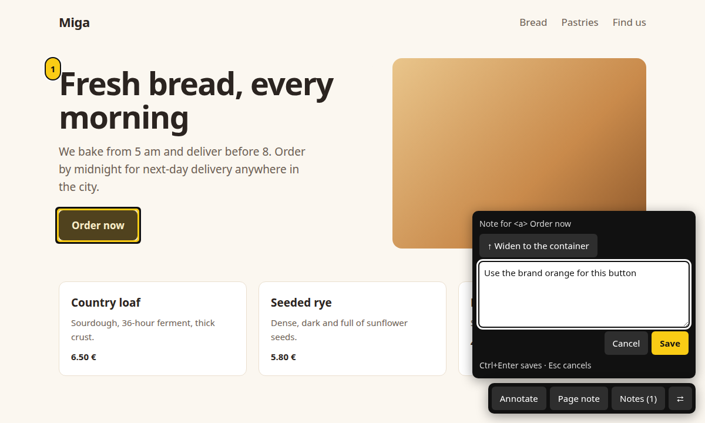
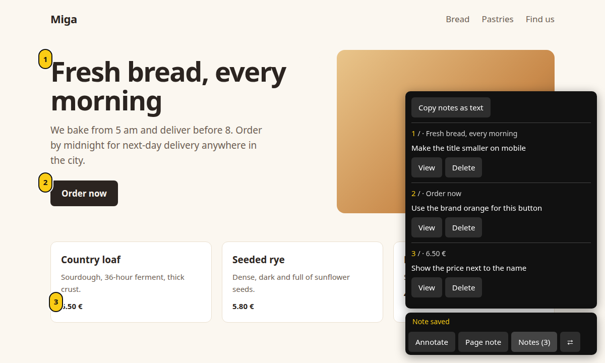

# annotate

[Website](https://codecruz.github.io/annotate/) · [Español](README.es.md)

Point at things on your locally running site, write what you want changed,
and let Claude Code carry out the notes.

`annotate` is a Claude Code plugin. It starts a small local proxy in front of
the site you are already serving, adds an annotation layer to every page and
saves your notes to `.annotations.json` in the project. When you are done,
Claude reads the file and does the work.

## Install

In Claude Code:

```
/plugin marketplace add codecruz/claude-plugins
/plugin install annotate@codecruz
```

Then start a new session, or run `/reload-plugins`.

## How it works

1. Serve your project locally as you always do.
2. Run `/annotate:start`, or just ask ("let me annotate the page").
3. Open the address Claude gives you, press **Annotate**, click an element
   and write the note. Repeat on any page.
4. Run `/annotate:apply`, or tell Claude you are done. It finds the source of
   each marked element, makes the change and removes the note. Pins that
   remain are pending work.

| Command | What it does |
| --- | --- |
| `/annotate:start [url or port]` | Opens a session on your local site. |
| `/annotate:apply` | Carries out the notes and removes the resolved ones. |
| `/annotate:stop` | Closes the session. Open notes are kept. |

## What it looks like

**1. Pick.** Press **Annotate** and point at the element. It is outlined as
you move.


**2. Write.** Say what you want in your own words. If the click landed too
deep, **Widen to the container** moves the note up one level.



**3. Review.** Each note leaves a numbered pin. **Notes** lists them across
pages, takes you to each one, and can copy them all as text.



**4. Apply.** Claude reads the notes, finds the code behind each element and
makes the change. In a real session on a portfolio site, ten notes left on
the home page were applied in one pass and the file came back empty: no
pins left means nothing is pending.

## The annotation layer

| Control | What it does |
| --- | --- |
| **Annotate** (`Alt+A`) | Starts picking. Click an element, or use the keyboard. |
| Arrow keys, then `Enter` | Walk the page while picking: up to the container, down into it, left and right between siblings. `Enter` picks. |
| **Widen to the container** | Moves the note to the parent element. |
| **Page note** | Leaves a note about the whole page. |
| **Save** (`Ctrl+Enter`) | Saves the note. Notes are written to disk on every change. |
| **Notes** | Lists every note, on any page. Edit, delete, or copy them all. |
| A pin | Reopens its note. |
| **⇄** | Moves the bar to the other corner when it covers something. |
| `Esc` | Cancels. |

The layer works with mouse, touch and keyboard, and with a screen reader. It
shows in Spanish when the browser language is Spanish and in English
otherwise. Write the notes in any language.

## What a note holds

```json
{
  "path": "/pricing",
  "selector": "#main > section > h1",
  "tag": "h1",
  "text": "Fresh bread, every morning",
  "html": "<h1 class=\"title\">Fresh bread, every morning</h1>",
  "viewport": "390x800",
  "theme": "dark",
  "note": "Too big on mobile"
}
```

The page, the element and its text, the window size and the colour theme
travel with the note, so "too big on mobile" arrives with its context. Each
note also has an `id`, the element's `classes` and a `created` date.

`.annotations.json` is working data, not source. Keep it out of version
control; Claude adds it to `.git/info/exclude` when it opens a session.

## Other AI tools

The proxy and the layer do not depend on Claude: they are plain Node and a
JSON file. Clone this repository and, with any other assistant:

```
node skills/annotate/server.mjs --proxy http://localhost:<site-port>
```

| Option | Default | Meaning |
| --- | --- | --- |
| `--proxy` | required | The local site to annotate. Only `localhost` is accepted. |
| `--port` | `4400` | Where the annotated copy is served. |
| `--out` | `.annotations.json` | The notes file, relative to the current folder. |
| `--open` | off | Opens the annotated copy in your default browser, in the foreground. |

Annotate, then either point the assistant at the notes file, or open
**Notes** and press **Copy notes as text** to get a Markdown brief you can
paste into any chat.

## Privacy and safety

- Everything stays on your computer. No accounts, no network calls, no
  analytics.
- The proxy only listens on `127.0.0.1` and only forwards to `localhost`.
- Notes are accepted only from the pages the proxy serves, so another site
  open in your browser cannot plant one.
- Your project files are not changed by the layer: it is added to the pages
  on the fly, only while the session is open.

## Requirements and limits

- Node 20 or later. No dependencies.
- Notes attach to an element or to the whole page, not to free regions or
  text selections.
- WebSockets are not forwarded, so hot reload does not work through the
  proxy: reload the page after a change.
- A strict Content-Security-Policy set in a `<meta>` tag blocks the layer.

## Develop

```
npm test                         # proxy tests, no dependencies
claude --plugin-dir .            # try the plugin from this checkout
```

| Path | What it is |
| --- | --- |
| `skills/annotate/SKILL.md` | What Claude does in a session. |
| `skills/annotate/server.mjs` | The proxy. |
| `skills/annotate/client.js` | The annotation layer. |
| `commands/` | The three slash commands. |
| `docs/` | The website, published with GitHub Pages. |

## License

MIT
